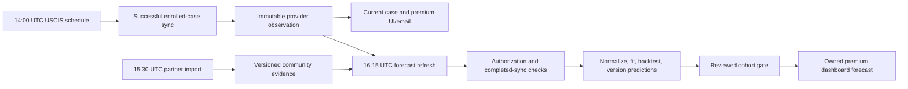

# Daily OPT forecast engine

Implementation: `apps/web/lib/opt-forecast`. Version: `opt-aj-v1`.
The existing community estimator remains in place. This release creates a
prospective evidence and validation pipeline; it does not certify greater
accuracy or activate an unvalidated prediction.

## Data contract and privacy

Migration `20261013133431_opt_forecast_observations.sql` adds:

| Store | Purpose / safeguard |
| --- | --- |
| `opt_case_identity` | Stable random application UUID shared only when the existing enrolled receipts match exactly. Stable across removal of one shared enrollment. No new receipt/hash copy. |
| `opt_case_observations` | Immutable successful provider observations and dated metadata revisions. `observed_at` is DB ingestion time; `synced_at` is successful provider-check time; raw allowlisted status events carry their own dates. Retried identical sync timestamp is idempotent. |
| `opt_community_observations` | Immutable copies of each future partner upsert, with original allowlisted date strings for correction audits. Import time is not pending confirmation. |
| `opt_forecast_policy` | Explicit source-use authorization reference and separately reviewed serving model/cohort artifact. Default closed; not client-writable. |
| `opt_forecast_runs` | Version, cutoff, curve inputs/outputs, aggregate backtest report and completion state. Ten-minute claims serialize workers; retry gets a new UUID so late writers cannot publish. |
| `opt_forecast_run_cases` | Membership for deletion invalidation; no persistent model survives removal of a contributing enrollment. |
| `opt_case_forecasts` | Exact calculated and returned forecasts, including calculation and shown times; tied to owned enrollment and model version. |

`case_status.reported_filing_date` and `reported_premium_start` preserve future
explicit user declarations separately from provider evidence. Old ambiguous
values are not relabeled as explicit declarations. Changing those declarations
creates an observation at the actual change time without refreshing USCIS
freshness. Changing a receipt invalidates that enrollment's previous history,
identity mapping and derived model records.

All new tables force RLS and revoke browser-role access. Only fixed server RPCs
can append evidence; functions have empty search paths and restricted execution.
Authenticated API reads require both an active premium subscription and exact
`case_id`/`user_id` ownership. Free users' daily evidence is retained but their
forecast/metrics API returns 403. Existing premium email behavior is unchanged.

Receipt identifiers remain in the existing access-controlled `case_status`
store; model tables and browser forecast responses do not duplicate them.
This change does not add application-level encryption to the legacy receipt
column or certify the provider's at-rest configuration. Normal Supabase
transport/storage controls and the existing identifier-store RLS remain
required. Internal UUIDs and timelines are still personal data, not anonymous.
No case descriptions, names, nationality, tokens, documents or whole USCIS
responses enter the model or diagnostics. Per-case source status/event fields
are preserved for audit; this is deliberately not a full raw HTTP archive.

Deleting an enrollment cascades its observations and forecasts and invalidates
model runs containing it. Another user's independently enrolled copy remains.
Community deletion cascades its snapshots. Backups have separate retention
controls. No departed-applicant training archive or quarantined cache reuse is
introduced. See [retention policy](../compliance/CASE_DATA_RETENTION.md).

## Statistical baseline

An application counts once. Every cutoff first reconstructs the knowledge
available by `observed_at <= cutoff`, including corrections only after they were
recorded. A current table row or newly discovered historical event is never
backdated to an earlier training cutoff.

The regular clock starts at the provider-reported receipt/submission date or
explicit original received event. User filing dates remain separate. No guess
from receipt prefixes or default OPT categories is used. Initial OPT and STEM
are separate; premium and regular-with-no-known-premium are separate. The latter
has an explicit quality flag because absence of premium evidence is not proof
of regular processing. Premium starts use an explicit provider start event,
then the user's dated declaration, then a flagged legacy value. Missing or
contradictory starts are ineligible.

For each clock, an application's interval is `(L, X]`, where `L` is its age at
the first **observed pending** check. `X` is the actual dated terminal event,
or its age at the last confirmed pending observation. Already-approved arrivals
do not retrospectively enter risk sets. Undated approvals are displayed as
approved without a fabricated date and contribute only prior confirmed pending
follow-up. Delayed reports retain their actual event date and later observation
time. Corrections can change future fits; previously shown forecasts remain.

At event age `u`, count `Y(u) = #{L < u <= X}`, approval events `dA`, and competing
events `dC`. Compute:

```
F_A(u) = F_A(u−) + S(u−) dA(u) / Y(u)
S(u)   = S(u−) [1 − (dA(u) + dC(u)) / Y(u)]
```

This is the Aalen–Johansen cumulative incidence estimator; with only approvals
it reduces to Kaplan–Meier. Denial, withdrawal and a regular-to-premium upgrade
are competing transitions, not approvals or ordinary independent censoring.
For a regular forecast, the estimand is approval **before switching to premium**.
Premium cases get a separate time-since-upgrade episode; the application is never
duplicated within either cohort. The baseline cannot estimate a counterfactual
"approval if nobody upgraded".

For a case still pending at age `t`, reset event-free survival to one at `t` and
accumulate the subsequent supported hazards. This is equivalent, where global
survival is identified, to:

```
P(approval by t+r | event-free at t) = [F_A(t+r) − F_A(t)] / S(t)
```

With no competing outcomes this is `1 − S(t+r)/S(t)`. The earliest supported
crossing of .10/.25/.50/.75/.90 supplies remaining-day quantiles. Calendar dates
are today plus those remaining times. If no new hazard step is crossed tomorrow,
remaining time decreases and the calendar quantile stays fixed; it is not simply
pushed forward one day.

Numerical safeguards require 30 distinct usable episodes, five approvals, and
15 subjects in the conditional risk set and every traversed risk interval.
These are conservative support guards, **not validated accuracy labels**.
An empty risk interval stops extrapolation. Unreached quantiles are null,
including when competing outcomes make a high approval quantile unidentifiable.
The new model does not apply the old 7–400 cutoff to verified events/pending ages.
Contradictory outcomes/dates, unknown form/category, stale subject checks over
two UTC days, and missing clocks prevent a precise forecast.

The fallback hierarchy is deliberately limited: recent receipt-window candidates
(30, 60, 90 days) are evaluated independently; the all-history same-kind/same-
processing baseline is the broader candidate. A production cohort never falls
across kind/processing boundaries. No source weights, calendar decay weights,
prefix centers, or unsupported status effects are fitted. If evidence remains
weak, return a qualified limited-data state and retain the separate historical
community comparison. No community pending duration is inferred from import time.

The I-765 premium legal clock is separately **30 business days to adjudicative
action**, not guaranteed approval. RFE/NOID can stop and restart that action
clock; the statistical episode remains time since the original upgrade. See
[8 CFR 106.4(e)(21), (f)](https://www.ecfr.gov/current/title-8/chapter-I/subchapter-B/part-106/section-106.4).

Reference: [R survival: competing risks and delayed entry](https://cran.r-project.org/web/packages/survival/vignettes/compete.pdf).
Independence of truncation/censoring and representativeness of tracked users are
assumptions requiring sensitivity review, not properties established by a daily
API call.

## Daily workflow and API



Refresh retries at 18:15 and 20:15 UTC. A successful daily run is idempotent;
queueing/running jobs delay it. Failed case checks remain censored at the previous
successful observation rather than being labeled current. Overdue sync at the
last refresh slot emits a static error. A failed/partial model write is never
published ready. No forecast operation calls USCIS or increases provider traffic.
The original scheduler/client quota and backoff continue to govern all USCIS calls.

`GET /api/case-status/forecast?case_id=<internal UUID>` returns `ok` and `forecast`:
`state`, `modelVersion`, `asOf`, `approvalDate`, `medianDate`, `interval50`,
`interval80`, `remainingDays`, `waitingDays`, `sampleSize`, `atRisk`,
`lastSuccessfulSync`, `modelUpdatedAt`, `reliability`, `explanation`.
All responses are private/no-store. The response is recorded before delivery.
The dashboard refreshes on a successful case check and UTC day boundaries.
An explicit verified approval replaces the forecast even while model serving
remains gated. High/Moderate labels are not emitted; Limited Data is used only
when a supported estimate cannot be produced. The 50/80 ranges are predictive
quantiles, not confidence intervals on parameter estimates.

## Release, monitoring and rollback

1. Run unit/route/UI tests, disposable PostgreSQL tests, migration validation,
   lint, type checks and build; require CI and Playwright before merge.
2. Apply only this additive migration to `deknauqkqqzwuvopqott`, rehearse first,
   record its actual version in the migration ledger and local manifest, and
   verify table/function grants, RLS, triggers and query plans. Never `db push`
   against the divergent production history.
3. Merge the scoped PR through required checks. Verify the exact commit on
   Vercel and Render. A merge deploys production. Verify metadata and aggregate
   counts after the first successful real synchronization, without exposing a
   receipt or running a synthetic production case.
4. Record the October 13 owner-provided review evidence and explicit confirmation
   that real tracked cases are independently authorized in `opt_forecast_policy`;
   enable `uscis_training_authorized` within that scope. Attach the promised
   consent/policy document when supplied. This does not enable customer forecasts.
   Keep the serving model null while collecting prospective evidence and evaluating it.
5. Review a locked out-of-sample report per cohort. Require sufficient independent
   applications across multiple calendar landmarks, supported censoring horizons,
   no material calibration/availability regressions, and demonstrated improvement
   over the legacy baseline. Check premium/date-quality sensitivity and source
   overlap. Choose thresholds prospectively before inspecting the holdout. Record
   `{modelVersion, approved, reviewedAt, reportReference, cohorts}` in `validation`
   and the exact `promoted_model` only after statistical review. There is no
   automatic self-promotion or unsubstantiated default performance claim.
6. Monitor daily run freshness, observation coverage, pending job count, data-quality
   exclusions, sample/risk counts, forecast availability, held-out MAE and IPCW
   calibration/Brier results by cohort and waiting age. Review degradation before
   broadening coverage. Status-aware/Cox/ML candidates need a new version and
   independent time-split evaluation; they are not silently enabled in v1.

Rollback: clear `promoted_model` immediately to restore the historical comparison
as the only predictive output; disable pooled training if source use is withdrawn.
Preserve observations subject to deletion policy. Revert code through a checked
PR if necessary; leave additive tables in place until a separately reviewed
cleanup. Do not discard evidence or undo privacy safeguards as a rollback.

All unexpected API, cron, persistence and browser failures use fixed Sentry
messages without applicant/provider payloads. Expected auth/validation/limited
evidence/review states are distinct from errors. See [Sentry operations](../ops/SENTRY.md).
Missing cron execution cannot report its own absence; external run-freshness
checking and the existing daily scheduler remain necessary. The free Sentry
quota, notification delivery, provider availability and inherited Render
compute/queue limits remain operational constraints. No paid monitor or plan
change is introduced.
